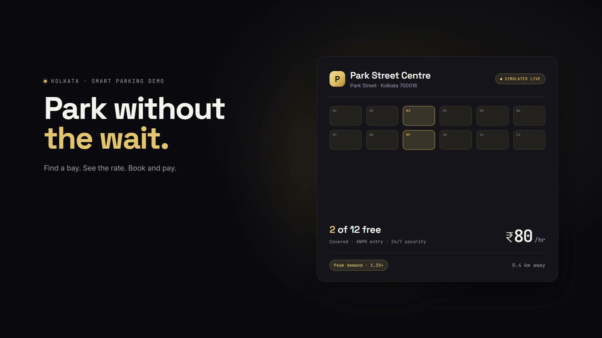
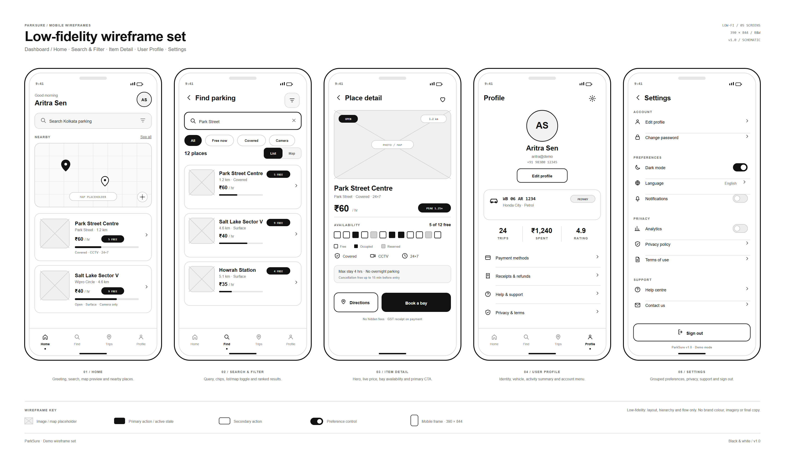
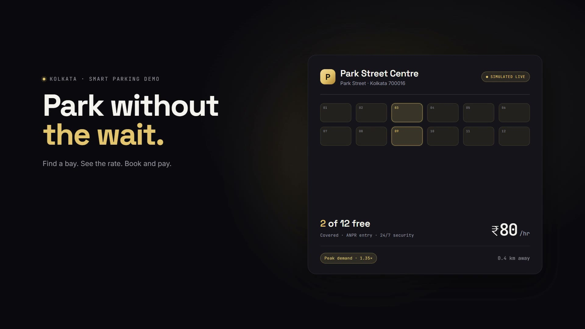
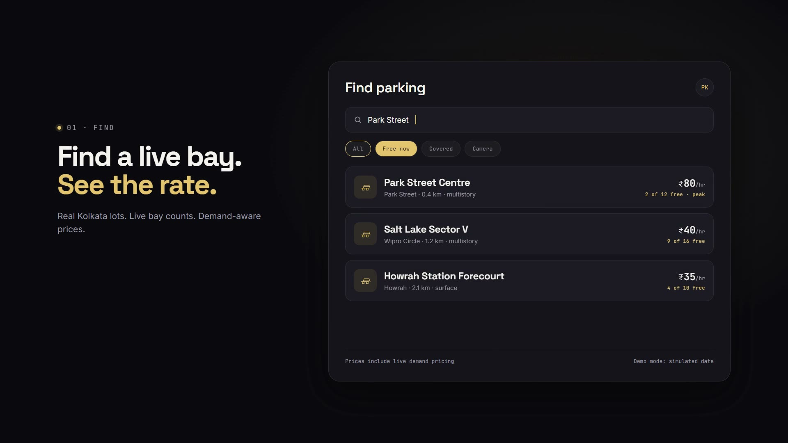
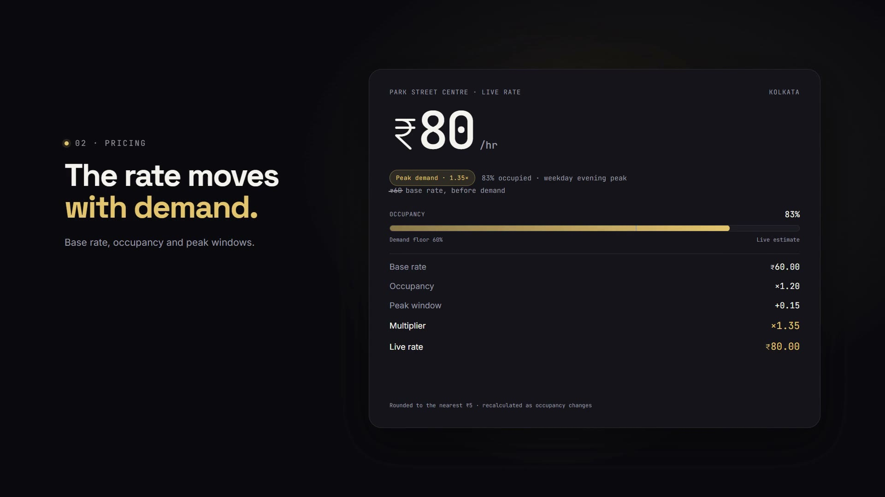
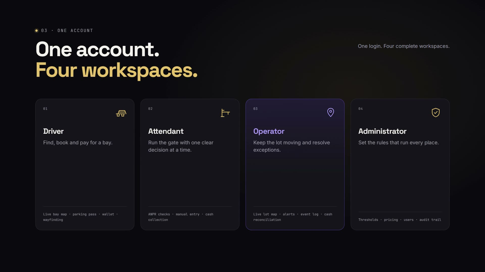
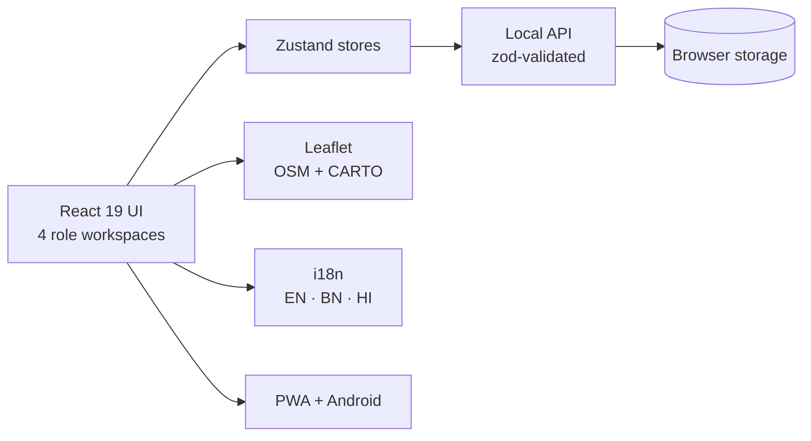

<div align="center">


## Amity University Kolkata
**Design Thinking for Innovation [IPDE211]** · Faculty: Dr Saberi Goswami

<br />



# ParkSure

### Smart parking for Kolkata, without the wait.

[**Live demo**](https://prateekcandwill.github.io/parksure-smart-parking-kolkata/) ·
[**Launch film**](brag-output/brag.mp4) ·
[**Wireframes**](wireframes/index.html) ·
[**Design decisions**](DESIGN_DECISIONS.md) ·
[**Test checklist**](TEST_CHECKLIST.md)


</div>

---

## Overview

Finding parking in Kolkata is a search problem wrapped in a trust problem. A driver circling Park Street does not know whether a bay is free, what it will cost, or whether the barrier will open.

**ParkSure** is a working, local-first prototype that answers all three: live bay estimates for four real Kolkata locations, a transparent demand-based price, an OpenStreetMap route, simulated booking and payment, and a QR pass that opens a gate. The same account also runs the attendant, operator and administrator sides of the lot, so one parking session can be followed end to end.

> **Demo mode:** everything runs in the browser on simulated data. No real sensors, gates or money are involved.

## The Team

| Name | Enrolment No. | Role |
| --- | --- | --- |
| **Prateek Kumar** | A910119824003 | Group Lead |
| Pritam Bhakta | A910119824029 | Team Member |
| Rajasree Dutta | A910119824023 | Team Member |
| Mittika Jana | A910119824031 | Team Member |

## Try It in 60 Seconds

1. Open the **[live demo](https://prateekcandwill.github.io/parksure-smart-parking-kolkata/)** on a phone or narrow window.
2. Sign in with OTP `123456` and password `demo1234` (public demo credentials).
3. As a **Driver**, open *Park Street Centre*, check the price breakdown, then book and pay.
4. Use the role chooser to switch to **Attendant**, **Operator** and **Administrator**. Switching never changes accounts.

## Problem and Point of View

| Problem | On the street |
| --- | --- |
| **Uncertainty before arrival** | Drivers cannot tell if a lot is free, so they circle and add to congestion. |
| **Opaque pricing** | A demand-based rate feels unfair unless the driver sees why it changed. |
| **Two systems, one lot** | Drivers and staff use different tools, so gate, cash and audit trail disagree. |

**Point of view:** *A driver near Park Street needs a trustworthy, live answer to "is there a bay, and what will it cost?", and the people running the lot need the same answer on their side of the barrier.*

## Wireframes

Low-fidelity grayscale wireframes for the five core mobile screens: dashboard, search and filter, place detail, profile and settings.

<p align="center">
  
</p>

Full presentation page: [`wireframes/index.html`](wireframes/index.html)

## Final Screens

| Home / live bay card | Find and filter | Dynamic pricing | Four workspaces |
| :---: | :---: | :---: | :---: |
|  |  |  |  |

## Key Features

| Workspace | What it does |
| --- | --- |
| **Driver** | Live bay estimates with confidence scores, transparent pricing, OSM map and wayfinding, booking, QR pass, card/UPI/wallet payment with 3-D Secure, GST receipt PDF, refunds, wallet and trip history. |
| **Attendant** | ANPR plate checks, manual entry, cash collection, one clear decision at a time. |
| **Operator** | Live lot map, alerts, event log, end-of-shift cash reconciliation. |
| **Administrator** | Occupancy and pricing thresholds, user roles, audit trail, CSV exports. |

**Across the product:** English, Bengali and Hindi; dark CRED-inspired design; mobile-first with 48 px touch targets; installable offline PWA plus a Capacitor Android build; contrast-checked, keyboard-friendly and reduced-motion aware; on-device rule-based support assistant.

## Design Thinking Process

| Stage | What it produced |
| --- | --- |
| **1. Empathize** | Two users with opposite pressures: a driver in a hurry and an attendant under queue pressure. Both need one unambiguous next action. |
| **2. Define** | The point of view above and the "same answer on both sides of the barrier" principle, which became the four-role model. |
| **3. Ideate** | Demand-based pricing with a visible breakdown, camera estimates for open grounds, a shared audit trail. |
| **4. Prototype** | Wireframes first, then a high-fidelity React app and Android shell with real Kolkata place names and prices. |
| **5. Test** | Automated contrast, link, mobile and smoke checks, plus the manual script in [TEST_CHECKLIST.md](TEST_CHECKLIST.md). |

**Principles:** show the reason, not just the number · one decision per screen for staff · disclose the simulation in plain words · design for one hand on a Kolkata street · keep the demo self-contained. More in [DESIGN_DECISIONS.md](DESIGN_DECISIONS.md).

## How Dynamic Pricing Works

```
base rate        ₹60.00 / hr        set by the administrator
occupancy lift   × 1.20             83% occupied against a 60% demand floor
peak window      + 0.15             weekday evening peak, 5–9 pm
multiplier       × 1.35
live rate        ₹80.00 / hr        ₹60 × 1.35 = ₹81, rounded to nearest ₹5
```

The UI shows this same arithmetic as a receipt. Code: [`src/utils/pricing.ts`](src/utils/pricing.ts).

## Tech Stack and Architecture

| Layer | Choice |
| --- | --- |
| UI | React 19, TypeScript, Vite 8, Tailwind CSS 3, Framer Motion |
| State and data | Zustand, Zod-validated local API, browser storage |
| Maps | Leaflet, OpenStreetMap data, CARTO tiles |
| Documents | jsPDF (GST receipts), QR codes (passes) |
| PWA / Android | `vite-plugin-pwa` (Workbox), Capacitor 8 |
| Tooling | oxlint, custom contrast / link / mobile / smoke scripts, Hyperframes (launch film) |



There is no server: the "API" is a typed module over browser storage, which shows what a real deployment would replace.

## Getting Started

Requires Node.js 22+ and npm.

```bash
git clone https://github.com/prateekcandwill/parksure-smart-parking-kolkata.git
cd parksure-smart-parking-kolkata
npm ci
npm run dev        # http://localhost:5173
```


## Repository Structure

```
parksure-smart-parking-kolkata/
├─ src/                  # React app: pages, components, stores, API, i18n, utils
├─ public/               # icons, social image, robots, sitemap
├─ scripts/              # postbuild, contrast, link, mobile and smoke checks
├─ wireframes/           # wireframe sheet + presentation page
├─ docs/                 # screenshots, college logo, full app guide
├─ brag-output/          # launch film, poster, share copy
├─ android/              # Capacitor Android project
├─ .github/workflows/    # GitHub Pages deployment
├─ DESIGN_DECISIONS.md · TEST_CHECKLIST.md · LAUNCH_CHECKLIST.md
└─ index.html · vite.config.ts
```

## Limitations

- All occupancy, payments, refunds, ANPR reads and gate openings are simulated.
- No backend: data lives in the browser; clearing site data restores the seed. Production would need a server and real authentication.
- Maps need a network; availability data works offline.
- The support assistant is rule-based, not a language model.
- Bot protection is client-side only. The Android APK is not committed; build it with `npm run android:build`.

## License

Released under the [MIT License](LICENSE). Map data, fonts and third-party libraries keep their own licenses.

## AI Disclosure

The ParkSure website and app were **AI-assisted**. The team used AI tools to help generate and refine code, interface copy and documentation. AI was used **as a tool**: the team defined the problem, point of view, four-role concept and design principles, and reviewed, tested and directed the output. The research and design-thinking work in the course submission is the team's own.

## Acknowledgements

Course **Design Thinking for Innovation [IPDE211]**, Faculty **Dr Saberi Goswami**. Map data © [OpenStreetMap](https://www.openstreetmap.org/copyright) contributors; tiles by [CARTO](https://carto.com/attributions). Built with React, Vite, Tailwind CSS, Leaflet, Zustand, Zod, jsPDF, Capacitor and Hyperframes. Typefaces: Inter, Space Grotesk, JetBrains Mono (SIL OFL).

<div align="center">

**ParkSure** · Made for Kolkata by Team ParkSure · AI-assisted · Demo mode: simulated data

</div>
